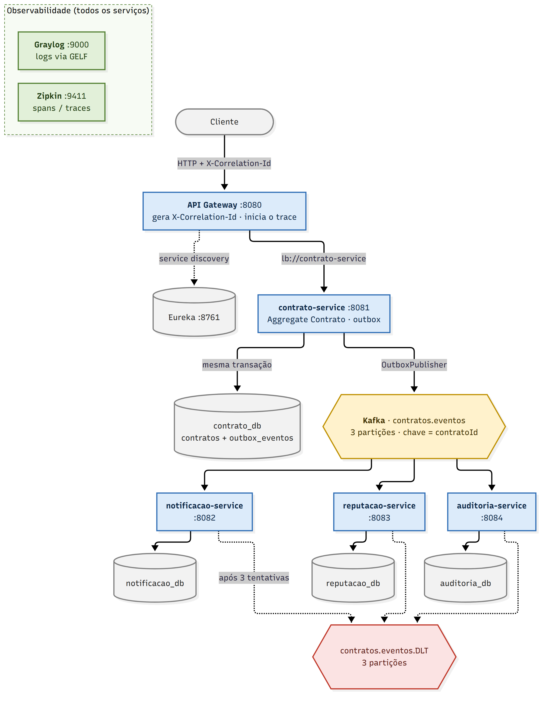

# Freela Marketplace — comunicação orientada a eventos

Evolução do projeto-base `freela-marketplace-assessment` para comunicação assíncrona entre os
microsserviços via Apache Kafka, com publicação transacional (outbox), processamento concorrente com
ordem por contrato, idempotência nos consumidores, Dead Letter Topic, logs centralizados (Graylog) e
rastreamento distribuído (Zipkin).

Documentos complementares:

- [docs/ESPECIFICACAO-EVENTOS.md](docs/ESPECIFICACAO-EVENTOS.md) — contrato de comunicação: eventos, tópicos, chave, payload e exemplos.
- [docs/EVIDENCIAS.md](docs/EVIDENCIAS.md) — roteiro de execução e evidências dos fluxos.
- [requests/freela.http](requests/freela.http) — chamadas de exemplo (IntelliJ / VS Code REST Client).
- [requests/insomnia-freela.json](requests/insomnia-freela.json) — as mesmas chamadas como coleção do Insomnia.

## Visão geral da arquitetura



Fonte do diagrama (Mermaid): [docs/arquitetura.mmd](docs/arquitetura.mmd). Todos os serviços enviam logs ao Graylog e spans ao Zipkin.

Não existe nenhuma chamada HTTP do `contrato-service` para os serviços auxiliares: toda alteração
relevante do contrato vira um evento no Kafka e os interessados reagem de forma assíncrona.

## Serviços

| Serviço | Porta | Papel | Banco |
|---|---:|---|---|
| `eureka-server` | 8761 | registro e descoberta | — |
| `api-gateway` | 8080 | entrada HTTP; gera/propaga `X-Correlation-Id`; inicia o trace | — |
| `contrato-service` | 8081 | ciclo de vida do contrato (DDD); produtor dos eventos via outbox | `contrato_db` |
| `notificacao-service` | 8082 | registra notificações para cliente e freelancer a cada evento | `notificacao_db` |
| `reputacao-service` | 8083 | mantém contadores do freelancer (concluídos, cancelados, valor total) | `reputacao_db` |
| `auditoria-service` | 8084 | registra todos os eventos processados pela plataforma | `auditoria_db` |

Infraestrutura: PostgreSQL 16 (um banco por serviço), Kafka 4 (KRaft) com Kafka UI (:8090),
Zipkin (:9411), Graylog 6 com OpenSearch e MongoDB (:9000).

## Domínio e eventos

O Aggregate `Contrato` (ATIVO → ENTREGA_REGISTRADA → CONCLUIDO; ATIVO/ENTREGA_REGISTRADA → CANCELADO)
produz um evento de domínio a cada transição:

| Operação HTTP | Evento |
|---|---|
| `POST /api/contratos` | `ContratoCriado` |
| `POST /api/contratos/{id}/entrega` | `EntregaRegistrada` |
| `POST /api/contratos/{id}/conclusao` | `ContratoConcluido` |
| `POST /api/contratos/{id}/cancelamento` | `ContratoCancelado` |

Transições inválidas respondem `409`; contrato inexistente, `404`.

## Tópicos Kafka

| Tópico | Partições | Produtor | Consumidores |
|---|---:|---|---|
| `contratos.eventos` | 3 | `contrato-service` | `notificacao-service`, `reputacao-service`, `auditoria-service` |
| `contratos.eventos.DLT` | 3 | os três consumidores (mensagens que falharam) | — (diagnóstico / reprocessamento manual) |

Um único tópico para todos os tipos de evento: a ordem só é garantida dentro de uma partição, e os
eventos de um mesmo contrato precisam ser consumidos na sequência em que ocorreram. Com tópicos
separados por tipo essa garantia se perderia.

Todos os serviços declaram os dois tópicos com 3 partições (`KafkaTopicosConfig`). Se um consumidor
subir antes do tópico existir, o broker o criaria com 1 partição e as partições adicionadas depois
só seriam percebidas no próximo refresh de metadata.

## Formato das mensagens

Envelope JSON (string UTF-8), chave = `contratoId`, headers `eventId`, `eventType`, `contratoId`,
`correlationId` e `traceparent`:

```json
{
  "eventId": "fd245ef8-5c16-4d3e-8fd0-9e9c7a1d7d3b",
  "eventType": "ContratoConcluido",
  "contratoId": "ad3db2b3-d9b2-41af-b1a9-6ca19c9f1965",
  "occurredAt": "2026-10-10T21:33:31.812Z",
  "correlationId": "corr-graylog-183325",
  "payload": {
    "eventId": "fd245ef8-5c16-4d3e-8fd0-9e9c7a1d7d3b",
    "occurredAt": "2026-10-10T21:33:31.812Z",
    "contratoId": "ad3db2b3-d9b2-41af-b1a9-6ca19c9f1965",
    "clienteId": "11111111-1111-1111-1111-111111111111",
    "freelancerId": "99999999-9999-9999-9999-999999999999",
    "valor": 640.0
  }
}
```

A especificação completa, por evento, está em [docs/ESPECIFICACAO-EVENTOS.md](docs/ESPECIFICACAO-EVENTOS.md).

## Publicação transacional (Transactional Outbox)

Gravar no banco e publicar no Kafka são dois sistemas sem transação em comum. Para não perder nem
inventar eventos, o `contrato-service` usa o padrão outbox:

1. O caso de uso (`ContratoApplicationService`) salva o Aggregate e, **na mesma transação**, registra
   cada evento de domínio na tabela `outbox_eventos` (`OutboxJpaAdapter`, com
   `@Transactional(propagation = MANDATORY)` — não existe fora da transação do Aggregate).
2. O `OutboxPublisher` roda a cada 1 s, lê os pendentes em ordem de criação, publica com chave
   `contratoId`, espera o `ack` do broker (`acks=all`, produtor idempotente) e só então marca
   `publicado_em`. Se um envio falhar, registra a tentativa e **interrompe o ciclo** — pular o
   evento quebraria a ordem dos eventos daquele contrato.
3. A linha da outbox guarda `correlationId`, `traceId` e `spanId` da requisição de origem, que
   viajam na mensagem (headers) e continuam o trace.

A entrega resultante é *at-least-once*: um evento pode ser publicado duas vezes se o processo cair
entre o envio e a marcação. É por isso que todos os consumidores são idempotentes.

## Processamento concorrente e ordenação

- Chave da mensagem = `contratoId` → `hash(chave) % 3` leva todos os eventos do mesmo contrato à
  mesma partição, onde o Kafka garante a ordem. Contratos diferentes se distribuem pelas partições.
- Cada consumidor usa `concurrency = 3` (uma thread por partição): paralelismo entre contratos,
  sequência dentro de cada contrato. Mais consumidores que partições só ficariam ociosos.
- Configuração: `app.kafka.particoes` e `app.kafka.concurrencia` nos `application.yml`.

## Idempotência

Cada evento tem um `eventId` único. Nos consumidores, a verificação e o efeito ocorrem **na mesma
transação**:

- `notificacao-service` e `reputacao-service`: tabela `eventos_processados` (`eventId` como chave
  primária). Se o id já existe, a mensagem é ignorada (`DUPLICADO_IGNORADO`); senão o efeito é
  aplicado e o id gravado junto. Isso impede notificações repetidas e contadores incrementados duas vezes.
- `auditoria-service`: o próprio registro de auditoria tem `eventId` com `UNIQUE`; além da
  verificação prévia, a constraint é a rede de segurança para entregas simultâneas.

Reprocessar um tópico inteiro (reset de offsets) não altera nenhum dado — ver evidências.

## Tratamento de falhas e DLT

`DefaultErrorHandler` em cada consumidor: 3 tentativas com 1 s de intervalo; esgotadas, a mensagem
original é publicada em `contratos.eventos.DLT` (mesma chave e partição) com os headers
`kafka_dlt-*` (serviço, tópico/partição/offset de origem, exceção e stacktrace). Exceções sem chance
de sucesso (JSON inválido, argumento inválido) vão direto para a DLT, sem retry. A falha de uma
mensagem só atrasa a partição dela pelo tempo dos retries; as demais partições e os outros
consumidores não são afetados. Cada tentativa e cada envio à DLT são logados com os ids da mensagem
(lidos dos headers quando o corpo nem pôde ser interpretado).

Para demonstrar: um contrato cujo título começa com `FALHA:` não consegue ser processado pela
notificação (gatilho de simulação em `ContratoEventosConsumer`).

## Logs e correlação

Toda linha de log, em todos os serviços, carrega `service`, `traceId`, `spanId`, `correlationId`,
`contratoId` e `eventId` (MDC):

```text
2026-10-10 21:33:32.155 INFO  service=reputacao-service traceId=6acaaf26… spanId=14a28d98… correlationId=corr-graylog-183325 contratoId=ad3db2b3… eventId=fd245ef8… thread=… logger=… - reputacao.evento.processado eventType=ContratoConcluido resultado=PROCESSADO
```

- `X-Correlation-Id`: gerado no Gateway quando ausente, propagado ao `contrato-service`, gravado na
  outbox, enviado no envelope e nos headers Kafka, e colocado no MDC de cada consumidor.
- Pontos registrados: recebimento da requisição, criação/transição do contrato, registro e
  publicação na outbox, recebimento, retry, DLT e resultado de cada mensagem nos consumidores.
- Nenhum dado sensível é logado (ids, status, tipos de evento e valores de contrato apenas).

### Centralização (Graylog)

Cada serviço tem um `logback-spring.xml` com dois appenders: console e **GELF UDP** (assíncrono,
`logback-gelf`) apontando para `graylog:12201`. Com `includeMdcData`, os campos do MDC viram campos
indexados no Graylog — a consulta `correlationId:<id>` devolve as linhas de todos os serviços de uma
operação; `contratoId:<id>` e `eventId:<id>` idem. O input GELF é criado automaticamente pelo
container `graylog-init` (`infra/graylog/criar-input-gelf.sh`). UI: http://localhost:9000, `admin` / `admin`.

### Rastreamento distribuído (Zipkin)

Micrometer Tracing (Brave) em todos os serviços, amostragem 100 %, exportando para
`http://zipkin:9411/api/v2/spans` (`management.tracing.export.zipkin.endpoint`). O contexto de
trace atravessa o Kafka: `spring.kafka.template.observation-enabled` e
`spring.kafka.listener.observation-enabled` propagam `traceparent` nos headers. Como o
`OutboxPublisher` roda fora da requisição, ele reabre o span `outbox publicar` como filho do
`traceId`/`spanId` guardados na outbox — por isso gateway, contrato, `send`, e os três `process`
aparecem no **mesmo trace**. UI: http://localhost:9411.

## Como executar

Requisitos: JDK 21+, Maven 3.9+, Docker Desktop (a stack completa usa cerca de 6 GB de RAM).

```bash
# 1) jars executáveis de todos os módulos
mvn -q -DskipTests package

# 2) infraestrutura + aplicações + observabilidade
cd infra
docker compose -f docker-compose.yml -f docker-compose.apps.yml -f docker-compose.observabilidade.yml up -d --build
```

Na primeira execução o Docker baixa as imagens (Kafka, PostgreSQL, OpenSearch, Graylog, Zipkin); o
Graylog leva 1–2 minutos para ficar disponível. Aguarde o Gateway registrar as rotas no Eureka (~30 s)
antes da primeira chamada.

| Componente | URL |
|---|---|
| API Gateway | http://localhost:8080 |
| Eureka | http://localhost:8761 |
| Kafka UI | http://localhost:8090 |
| Zipkin | http://localhost:9411 |
| Graylog | http://localhost:9000 (admin / admin) |

Para encerrar: `docker compose -f docker-compose.yml -f docker-compose.apps.yml -f docker-compose.observabilidade.yml down`
(`-v` para apagar também os dados).

Alternativa para desenvolvimento: subir só a infraestrutura
(`docker compose -f docker-compose.yml -f docker-compose.observabilidade.yml up -d`) e rodar os
módulos pela IDE ou com `mvn -pl <módulo> spring-boot:run`; os defaults dos `application.yml` apontam
para `localhost`.

## Exemplos de chamadas

```bash
# criar (gera ContratoCriado)
curl -i -X POST http://localhost:8080/api/contratos \
  -H 'Content-Type: application/json' -H 'X-Correlation-Id: demo-001' \
  -d '{"clienteId":"11111111-1111-1111-1111-111111111111","freelancerId":"22222222-2222-2222-2222-222222222222","titulo":"Construção de API de pagamentos","valor":3500.00}'

# entrega e conclusão (EntregaRegistrada, ContratoConcluido) — use o id retornado acima
curl -X POST http://localhost:8080/api/contratos/{id}/entrega   -H 'X-Correlation-Id: demo-001'
curl -X POST http://localhost:8080/api/contratos/{id}/conclusao -H 'X-Correlation-Id: demo-001'

# cancelamento (ContratoCancelado) — em outro contrato ativo
curl -X POST http://localhost:8080/api/contratos/{id}/cancelamento

# consultas nos consumidores
curl http://localhost:8080/api/notificacoes
curl http://localhost:8080/api/reputacoes
curl http://localhost:8080/api/auditoria
```

Mais chamadas, incluindo os cenários de falha, em [requests/freela.http](requests/freela.http).

## Testes

```bash
mvn test
```

- **Unitários** (sem broker nem banco): regras do Aggregate e eventos emitidos (`ContratoTest`);
  `OutboxPublisher` com `KafkaTemplate` simulado — chave `contratoId`, headers, ordem de publicação
  e interrupção do ciclo na falha (`OutboxPublisherTest`); idempotência e reações de cada consumidor
  (`ReputacaoServiceTest`, `NotificacaoServiceTest`, `AuditoriaServiceTest`).
- **Integração com broker embutido** (`spring-kafka-test`, Kafka em memória com 3 partições, H2 no
  lugar do PostgreSQL): o caso de uso real publica via outbox e as mensagens chegam na mesma partição
  e na ordem das transições (`OutboxKafkaIntegrationTest`); o consumidor de reputação recebe a mesma
  mensagem duas vezes sem incrementar duas vezes e processa os eventos de um contrato na ordem de
  publicação (`ConsumidorKafkaIntegrationTest`).

## Ajustes feitos no projeto-base

- `maven-compiler-plugin` com `-parameters`: sem o `spring-boot-starter-parent`, os `@PathVariable`
  sem nome explícito respondiam `400` (inclusive o `GET /api/contratos/{id}` original).
- `spring-boot-maven-plugin` com a execução `repackage`, para gerar jars executáveis para o Docker.
- As consultas `GET /api/notificacoes`, `/api/reputacoes` e `/api/auditoria` devolviam `[{}]`
  (entidades sem getters); passaram a usar records de resposta.
- `Dockerfile` único parametrizado por módulo e `infra/docker-compose.apps.yml` para subir as
  aplicações na mesma rede da infraestrutura.

## Tecnologias

Java 21 · Spring Boot 4.1 · Spring Cloud (Gateway, Eureka, LoadBalancer) · Spring Kafka ·
Spring Data JPA · PostgreSQL 16 · Apache Kafka 4 (KRaft) · Micrometer Tracing (Brave) + Zipkin ·
Logback + logback-gelf + Graylog 6 (OpenSearch, MongoDB) · Docker Compose · Maven
